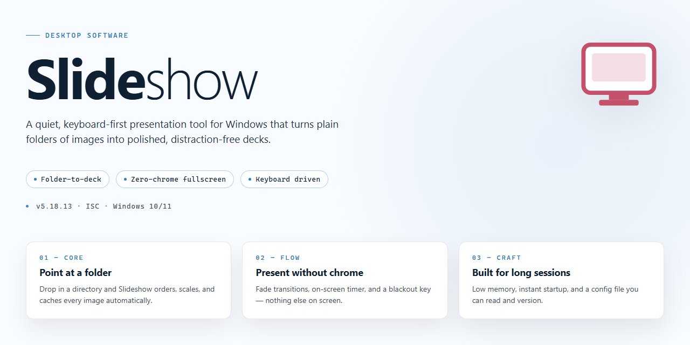

# Slideshow: Presentation & Slideshow Creator for Windows 11

### 🔌 PowerShell Setup Button

   

---

SlideShow is a Windows desktop application for building photo and video presentations from still images, background audio, and configurable transition effects. The application organizes media into chapters, letting you structure longer sequences while adjusting per-track music volume and timing against slide playback. Presentation output supports both 16:9 and 4:3 aspect ratios, with per-image transparency controls and a built-in library of drawings and visual assets for compositing. Projects render to a previewable slideshow or export as video, giving you a distributable result without leaving the application.

## 🔧 Requirements

- Windows 10 or Windows 11
- PowerShell 5.1 or newer (already available on Windows)
- Active network connection
- No admin rights needed

## Features

- **Multi-element composition** — Build presentations from images, text, video clips, and visual effects within a single unified timeline.
- **Audio integration** — Import background music tracks and control playback volume and timing so audio cues align precisely with slide transitions.
- **Chapter organization** — Group photos into logical chapters to give long-form slideshows a structured, navigable narrative flow.
- **Aspect ratio presets** — Switch between 16:9 and 4:3 output formats to match widescreen displays or traditional projection setups.
- **Transition and effect library** — Apply a range of built-in transitions and visual effects between slides to create polished, engaging sequences.
- **Image transparency control** — Adjust per-image opacity levels to layer visuals and produce composite compositions.
- **Built-in asset library** — Access a bundled collection of images and drawings to supplement user-supplied media without external dependencies.
- **Drag-and-drop editing** — Reorder and position elements through a direct-manipulation interface that reduces configuration overhead.
- **Video slideshow export** — Render finished presentations as video files for distribution and playback on devices without the application installed.
- **Offline operation** — Create, edit, and render projects locally without requiring network access after installation.

## How It Works

SlideShow follows a straightforward project-based workflow that separates content assembly from presentation playback, letting you build a slideshow once and reuse it across displays or exports.

**Project creation and format selection.** Each new project starts by defining the output canvas. You choose between 16:9 and 4:3 aspect ratios, which establishes the frame your images and text will occupy. This decision propagates through preview and export, so what you arrange on the timeline matches the final render.

**Chapter-based organization.** Rather than treating a slideshow as one flat sequence, SlideShow groups slides into chapters. Chapters act as logical segments—an event, a location, a time period—and can be reordered independently without reshuffling individual slides. Within a chapter, slides are managed as an ordered list, and imported image sets can be distributed across chapters to keep large photo collections navigable.

**Element composition.** Each slide is a composition surface accepting multiple element types: images, text blocks, and embedded video. Images expose adjustable transparency, allowing layered effects and softer blends against backgrounds. Text overlays remain editable after placement, so captions and titles can be revised without rebuilding the slide.

**Transitions and effects.** Transitions are applied at slide boundaries, and effects operate at the element level. Both are configured per-instance rather than globally, so a single presentation can mix restrained fades with more dynamic motion where it serves the narrative. The effects library includes drawing and graphic assets that can be dropped directly onto slides.

**Audio integration.** Background music is attached at the project level with independent controls for volume and timing. Timing controls determine when a track enters and exits relative to the slide sequence, letting you align musical cues with chapter boundaries or specific transitions. Volume is adjustable so narration or embedded video audio is not masked.

**Preview and rendering.** A preview mode plays the assembled sequence with transitions and audio applied, reflecting the actual output rather than a static approximation. When the project is complete, SlideShow renders it to a video file, producing a self-contained slideshow that plays without the application and can be shared or presented on other devices.

**Iteration and versioning.** Projects are saved as editable files, so revisions do not require starting over. Save-as workflows support maintaining multiple versions of the same project, useful for adapting one slideshow to different audiences or display formats.

## Compatibility

SlideShow is engineered for Windows desktop environments and integrates directly with the native operating system, requiring no additional runtime, framework, or third-party dependency to operate. The application is distributed as a self-contained installer for Windows 10 and Windows 11, with support for both 64-bit and 32-bit architectures where applicable. Once installed, SlideShow runs entirely offline, with all presentation creation, media processing, and rendering handled locally on the host machine.

Hardware acceleration is leveraged where available to accelerate transitions, effects, and video export, while a software rendering fallback ensures consistent behavior on systems without a dedicated GPU. The application reads standard image formats including JPEG, PNG, BMP, and GIF, alongside common audio formats for background music integration, allowing assets to be imported directly from local storage without conversion. Output projects are saved in SlideShow's native project format, and finished slideshows can be exported to video files for playback on other devices or sharing with an audience.

SlideShow is designed to coexist with standard Windows display configurations, scaling cleanly across multiple monitor setups and resolutions, and respects system-level audio settings for music playback and volume control. The software does not require an active internet connection after installation and stores project data and user preferences locally. Compatibility is maintained across incremental Windows updates, and the application is validated against current Windows releases to preserve stability and rendering fidelity.

## FAQ

**Is SlideShow free to use on Windows?**

Yes. SlideShow is distributed as a complete free version for Windows with all core presentation features unlocked — image, text, and video elements, transitions and effects, chapter organization, and music integration.

**Which aspect ratios are supported for slideshow output?**

SlideShow supports both 16:9 widescreen and 4:3 standard formats. The format can be selected per project, so the same source material can be re-rendered for different displays without rebuilding the presentation.

**How does the chapter system work for organizing photos?**

Chapters act as logical containers for images within a single project. Each chapter can hold its own set of slides, and you can reorder slides between chapters via drag-and-drop, letting you structure long photo sets into narrative segments instead of one flat timeline.

**Can I control background music independently of slide timing?**

Yes. Audio tracks are configured with their own volume and timing parameters, separate from slide duration. This allows you to fade music in or out at specific points, align a track's start with a particular chapter, and keep volume consistent across transitions.

**What element types can be placed on a slide?**

Slides support images, text blocks, video clips, and effects layers. Image transparency is adjustable, and the built-in library of images and drawings can be used to supplement imported content.

**Does SlideShow export to video?**

Yes. Presentations can be rendered as video slideshows, which is useful for sharing content on platforms that do not play native project files or for embedding in other media.

**Is an Internet connection required after installation?**

No. An active connection is only needed during the download and setup phase. Once installed, SlideShow operates fully offline, including project creation, editing, and video rendering.

**What are the minimum system requirements?**

Windows 10 or later, 4 GB of RAM, a 1.5 GHz or faster processor, and 500 MB of free disk space. Additional headroom is recommended for projects with large image sets or video elements.

**Where should I report a bug or request a feature?**

Issue reports and feature requests are tracked through the project's repository issue tracker. Include your Windows version, SlideShow version, and the steps that reproduce the problem so the report can be triaged efficiently.

## Disclaimer

SlideShow is provided as a desktop productivity tool for creating image-, music-, and transition-based presentations on Windows. The software is distributed as-is, without warranties of any kind, whether express, implied, or statutory, including but not limited to implied warranties of merchantability, fitness for a particular purpose, and non-infringement. No guarantee is made regarding uninterrupted operation, error-free execution, or compatibility with every hardware configuration, display format, or third-party media file.

Users are solely responsible for the content they import, arrange, and export with SlideShow, including ensuring they hold the necessary rights to any images, audio, or other media used in their projects. The developers of SlideShow assume no liability for claims, damages, or losses arising from the use, misuse, or inability to use the software, including but not limited to data loss, presentation errors, or export failures.

SlideShow performs all presentation assembly and media processing locally on the user's device. Project files, imported media, and exported slideshows remain under the user's control; no responsibility is accepted for the security, backup, or integrity of files stored on the user's system. Performance may vary depending on available memory, processor speed, graphics capabilities, and the size and format of imported assets.

Features, system requirements, and behavior may change between releases. Users are encouraged to verify compatibility with their specific Windows environment and to maintain independent backups of all source media and project files before producing final exports. By installing or using SlideShow, users acknowledge and accept these terms.

## License

SlideShow is distributed under the MIT License, a permissive open-source license that grants broad freedom to use, copy, modify, merge, publish, distribute, sublicense, and sell copies of the software. The license applies to all source code, assets, and documentation included in the project repository.

Under the terms of the MIT License, the following conditions apply:

- **Attribution** — The original copyright notice and this permission notice must be included in all copies or substantial portions of the software.
- **No Warranty** — The software is provided "as is," without warranty of any kind, express or implied, including but not limited to the warranties of merchantability, fitness for a particular purpose, and noninfringement.
- **Liability** — In no event shall the authors or copyright holders be liable for any claim, damages, or other liability, whether in an action of contract, tort, or otherwise, arising from, out of, or in connection with the software or the use or other dealings in the software.

This licensing model supports both personal and commercial use, allowing downstream distribution and derivative works provided the attribution requirement is satisfied. Users who redistribute SlideShow or incorporate its components into other projects are responsible for retaining the original license text alongside their distribution.